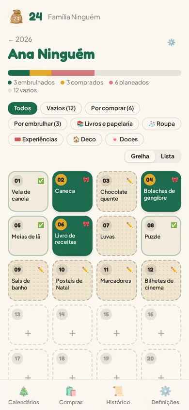
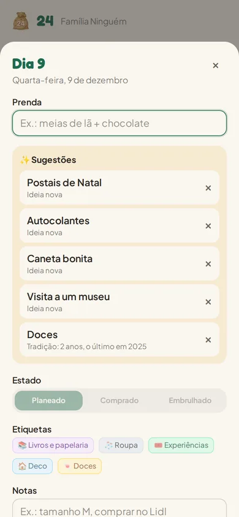
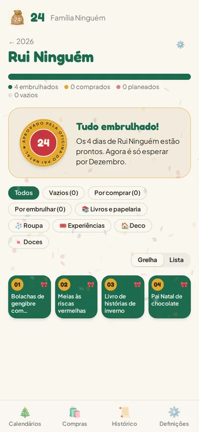

<p align="center">
  
</p>

<p align="center">
  <a href="https://github.com/Seven-Panda-Labs/24/actions/workflows/ci.yml"></a>
  <a href="https://github.com/Seven-Panda-Labs/24/blob/main/package.json"></a>
  <a href="LICENSE"></a>
</p>

# 24

**Português** · [English](#english)

<a id="portugues"></a>

## Português

O caos organizado de Dezembro. PWA para planear calendários de advento: 24 dias, 24 pequenas prendas, por pessoa e por ano. Funciona offline e sincroniza via Firebase.

<p align="center">
  
  
  
</p>

- Vários calendários por ano, um por pessoa, cada um partilhado por convite só com quem o deve ver
- Grelha de 24 portas e vista em lista; cada dia com prenda, estado, etiquetas, notas e foto
- Lista de compras e lista do que falta embrulhar, mesmo sem rede
- Sugestões a partir do histórico: tradições, prendas esquecidas e ideias novas
- Histórico pesquisável e importação do Excel antigo
- Lembretes opcionais ao domingo, de Novembro ao Natal
- Português, inglês, alemão e francês, modo claro e escuro

O produto e o plano estão em [`docs/project_brief.md`](docs/project_brief.md).

**Arrancar** (Node.js 24, Java 21+ para os emuladores):

```bash
npm install && npm --prefix functions install
cp .env.emulator.example .env.development.local
npm run emulators    # terminal 1
npm run dev          # terminal 2
```

Com um projeto Firebase teu: [`docs/self-hosting.md`](docs/self-hosting.md). Para contribuir: [`CONTRIBUTING.md`](CONTRIBUTING.md).

| Documento | Conteúdo |
|-----------|----------|
| [`project_brief.md`](docs/project_brief.md) | Produto, âmbito e épicos |
| [`architecture.md`](docs/architecture.md) | Como as peças encaixam |
| [`configuration.md`](docs/configuration.md) | Variáveis de ambiente |
| [`emulators.md`](docs/emulators.md) | Desenvolvimento local sem cloud |
| [`self-hosting.md`](docs/self-hosting.md) | Deploy num projeto Firebase teu |
| [`importing-the-excel.md`](docs/importing-the-excel.md) | Importar o Excel original |
| [`visual-identity.md`](docs/visual-identity.md) | Paleta, tipografia e tokens |

Licença [AGPL-3.0](LICENSE). Segurança: [`SECURITY.md`](SECURITY.md).

<a id="english"></a>

## English

[Português](#portugues)

December's organized chaos. A PWA to plan advent calendars: 24 days, 24 small gifts, per person and per year. Works offline and syncs via Firebase.

- Several calendars a year, one per person, each shared by invite only with those who should see it
- A 24-door grid and a list view; each day has a gift, status, tags, notes and a photo
- Shopping list and a list of what is left to wrap, even offline
- Suggestions from history: traditions, forgotten gifts and new ideas
- Searchable history and an import for the old spreadsheet
- Optional Sunday reminders from November to Christmas
- Portuguese, English, German and French, light and dark mode

The product and the plan are in [`docs/project_brief.md`](docs/project_brief.md) (Portuguese).

**Run it** (Node.js 24, Java 21+ for the emulators):

```bash
npm install && npm --prefix functions install
cp .env.emulator.example .env.development.local
npm run emulators    # terminal 1
npm run dev          # terminal 2
```

With your own Firebase project: [`docs/self-hosting.md`](docs/self-hosting.md). To contribute: [`CONTRIBUTING.md`](CONTRIBUTING.md).

| Doc | Contents |
|-----|----------|
| [`project_brief.md`](docs/project_brief.md) | Product, scope and epics |
| [`architecture.md`](docs/architecture.md) | How the pieces fit |
| [`configuration.md`](docs/configuration.md) | Environment variables |
| [`emulators.md`](docs/emulators.md) | Local development without the cloud |
| [`self-hosting.md`](docs/self-hosting.md) | Deploy to your own Firebase project |
| [`importing-the-excel.md`](docs/importing-the-excel.md) | Import the original Excel |
| [`visual-identity.md`](docs/visual-identity.md) | Palette, typography and tokens |

License [AGPL-3.0](LICENSE). Security: [`SECURITY.md`](SECURITY.md).
