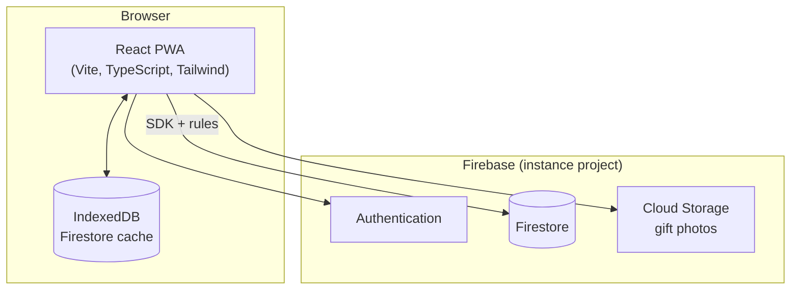

# Architecture

How the PWA and Firebase fit together. Product scope: [`project_brief.md`](./project_brief.md). Deploy: [`self-hosting.md`](./self-hosting.md).



The PWA reads and writes Firestore and Storage directly, guarded by `firestore.rules` and `storage.rules`. There are no Cloud Functions yet: the suggestion engine runs in the browser over the user's history (brief, section 4.4). Add a `functions/` package when something needs elevated privileges or a schedule, such as push reminders (brief, section 4.8).

## Code layout

| Location | Holds |
|----------|-------|
| `src/domain/` | Types and pure logic (progress, filters, dates), unit tested |
| `src/data/` | Firestore writes, one module per collection |
| `src/workspace/WorkspaceContext.tsx` | Subscribes to the user's workspaces, invites, calendars and tags; every page reads from it |
| `src/auth/` | Firebase Auth session |
| `src/pages/`, `src/components/` | Screens and shared UI |
| `src/services/firebase.ts` | Firebase app, Auth, Firestore (offline cache) and Storage, emulator wiring |
| `src/i18n/` | i18next setup and the `pt` and `en` locales |
| `src/styles/globals.css` | Tailwind theme tokens and base components, see [`visual-identity.md`](./visual-identity.md) |
| `public/` | Icons and illustrations cropped from `docs/assets/` |
| `scripts/` | Node scripts run with `tsx`: changelog check, Excel import ([`importing-the-excel.md`](./importing-the-excel.md)) |

## Data model

```
workspaces/{wid}                 name, ownerId, memberIds[], members{uid: {name, email}}, invitedEmails[]
  calendars/{cid}                year, person, name, startDate, dayCount, allowRepeats, originality,
                                 days{"1": {gift, status, tagIds[], notes}, ...}
  tags/{tid}                     name, color, emoji
```

A **workspace** is the family space. `memberIds` is there for the "my workspaces" query, `members` for showing names; the rules keep them in step. Any member can rename it and invite; only the owner removes members.

**Invites** are emails in `invitedEmails`. The invited person finds them with an `array-contains` query on their verified email and joins by adding themselves to `memberIds` and `members` and removing their email, in one update the rules check field by field.

A **calendar** keeps its days in a map keyed by day number, so a year of history is one document per calendar. Days are written by field path (`days.5`), so two people editing different days never overwrite each other. A missing key is an empty day.

**Tags** start as the five defaults in `src/domain/tags.ts`; their ids are stable and other code refers to them.

Rules: [`firestore.rules`](../firestore.rules), tested in [`firestore.rules.test.ts`](../firestore.rules.test.ts) against the emulator. Indexes: [`firestore.indexes.json`](../firestore.indexes.json). Storage rules deny everything until gift photos land.

## Offline

- Firestore uses the persistent multi-tab cache, so reads and queued writes survive without network and sync on reconnect.
- Writes are not awaited (`src/data/report.ts`): offline they only resolve on reconnect, and the listeners already show the local change.
- Listeners the server refuses are retried with backoff (`useDocs` in `WorkspaceContext.tsx`), because a listen can reach the server before the write that grants access.
- The `vite-plugin-pwa` service worker precaches the app shell; navigation falls back to `/index.html`, except `/__/*`, which Firebase Hosting serves for auth.

## Local development

Emulators for Auth, Firestore and Storage: [`emulators.md`](./emulators.md). Environment variables: [`configuration.md`](./configuration.md).
