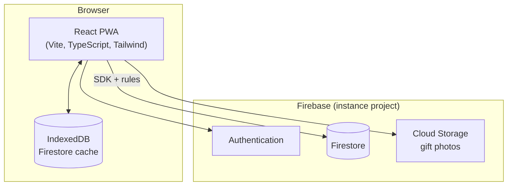

# Architecture

How the PWA and Firebase fit together. Product scope: [`project_brief.md`](./project_brief.md). Deploy: [`self-hosting.md`](./self-hosting.md).

The PWA reads and writes Firestore and Storage directly, guarded by `firestore.rules` and `storage.rules`. There are no Cloud Functions yet: the suggestion engine runs in the browser over the user's history (brief, section 4.4). Add a `functions/` package when something needs elevated privileges or a schedule, such as push reminders (brief, section 4.8).

## Code layout

| Location | Holds |
|----------|-------|
| `src/services/firebase.ts` | Firebase app, Auth, Firestore (offline cache) and Storage, emulator wiring |
| `src/i18n/` | i18next setup and the `pt` and `en` locales |
| `src/styles/globals.css` | Tailwind theme tokens, see [`visual-identity.md`](./visual-identity.md) |
| `public/` | Icons generated from `docs/assets/Logo/logo.jpeg` |

## Firestore

Rules and indexes: [`firestore.rules`](../firestore.rules), [`firestore.indexes.json`](../firestore.indexes.json), tested in [`firestore.rules.test.ts`](../firestore.rules.test.ts) against the emulator. Both rules files deny everything until the data model lands with epic E2.

## Offline

- Firestore uses the persistent multi-tab cache, so reads and queued writes survive without network and sync on reconnect.
- The `vite-plugin-pwa` service worker precaches the app shell; navigation falls back to `/index.html`, except `/__/*`, which Firebase Hosting serves for auth.

## Local development

Emulators for Auth, Firestore and Storage: [`emulators.md`](./emulators.md). Environment variables: [`configuration.md`](./configuration.md).
