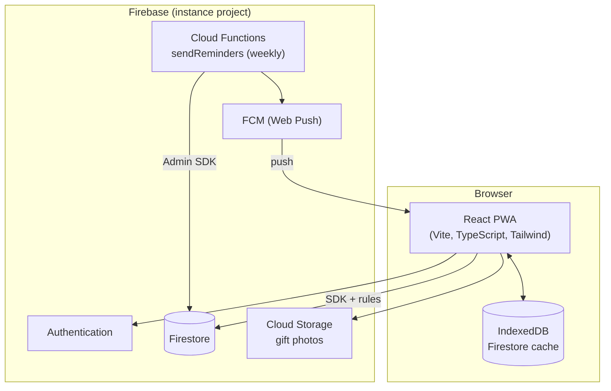

# Architecture

How the PWA and Firebase fit together. Product scope: [`project_brief.md`](./project_brief.md). Deploy: [`self-hosting.md`](./self-hosting.md).



The PWA reads and writes Firestore and Storage directly, guarded by `firestore.rules` and `storage.rules`. The suggestion engine runs in the browser over the history of the user's calendars (brief, section 4.4). The only Cloud Function is the weekly reminder, see [Reminders](#reminders).

## Code layout

| Location | Holds |
|----------|-------|
| `src/domain/` | Types and pure logic (progress, filters, dates), unit tested |
| `src/data/` | Firestore writes, one module per collection |
| `src/calendars/CalendarsContext.tsx` | Subscribes to the calendars the user is in and those that invited them; every page reads from it |
| `src/auth/` | Firebase Auth session |
| `src/pages/`, `src/components/` | Screens and shared UI |
| `src/services/firebase.ts` | Firebase app and Auth, emulator wiring |
| `src/services/firestore.ts` | Firestore (offline cache) and Storage, loaded only with the signed-in app (`src/SignedInApp.tsx`) |
| `src/i18n/` | i18next setup and the `pt`, `en`, `de` and `fr` locales |
| `src/styles/globals.css` | Tailwind theme tokens and base components, see [`visual-identity.md`](./visual-identity.md) |
| `public/` | Icons and illustrations cropped from `docs/assets/` |
| `functions/` | Cloud Functions (`sendReminders`), its own package and lockfile; `npm run check` builds it |
| `scripts/` | Node scripts run with `tsx`: changelog check, Excel import ([`importing-the-excel.md`](./importing-the-excel.md)) |

## Data model

```
calendars/{cid}                  year, person, name, startDate, dayCount, allowRepeats, originality,
                                 days{"1": {gift, status, tagIds[], notes, fromSuggestion?, photoPath?, photoUrl?, thumbUrl?}, ...},
                                 sack{"<id>": {the same fields as a day}},
                                 tags{"<id>": {name, color, emoji}},
                                 memberIds[], members{uid: {name, email}}, invitedEmails[]
  feedback/{fid}                 gift, action (accepted | dismissed), at
people/{uid}                     name, email, status (pending | approved | rejected), admin?
users/{uid}                      fcmTokens[], language
```

A **calendar** is what people share, one by one: two parents can each keep a secret calendar for the other and fill the children's together. A new calendar is only its creator's. `memberIds` is there for the "my calendars" query, `members` for showing names; the rules keep them in step. Everyone in a calendar can do everything in it: edit, invite, take others out, leave and delete it. Nobody is added without accepting an invite, and the last one in can only delete it.

Until 0.18.0 calendars lived in a family space (`workspaces/{wid}`) shared as a whole. `npm run migrate:calendars` copies an instance over, see [`self-hosting.md`](./self-hosting.md#upgrading-to-0180).

**Invites** are emails in `invitedEmails`. The invited person finds them with an `array-contains` query on their verified email and can read the calendar, since the invite lives in it. They join by adding themselves to `memberIds` and `members` and removing their email, in one update the rules check field by field, or decline by removing only their email.

**People** lists everyone who has signed in, so the admin can approve them and the Share page can suggest them. A first sign-in lists the account as `pending`, and [`AccessGate`](../src/account/AccessGate.tsx) shows a waiting page until the admin sets it to `approved`; it switches as soon as that changes. The rules give calendars, feedback and photos only to approved accounts, and the people list only to them too: anyone else reads just their own entry. An entry without a status, from before approval, counts as pending.

The **admin** approves, rejects or blocks accounts in Settings, and the home page tells them when someone is waiting. Only the admin writes a status, never their own, and only the Admin SDK writes the `admin` flag: `npm run admin:grant`, see [`self-hosting.md`](./self-hosting.md#4-post-deploy). Picking a suggestion on the Share page only fills the email field, so a stray tap never invites someone to a calendar kept secret from them.

A calendar keeps its days in a map keyed by day number, so a year of history is one document per calendar. Days are written by field path (`days.5`), so two people editing different days never overwrite each other. A missing key is an empty day.

The **sack** holds a calendar's gifts without a day yet, in the same document, keyed by ids that sort by when they went in. Putting a gift on a day, or back in the sack, is one write that deletes it from one map and sets it in the other. The progress and the weekly reminder count the sack towards the empty days, the furthest along first; gifts past that are spare ideas. Two people moving the same gift offline at the same time can end up with it on two days: preventing that would take a transaction, and transactions need a connection.

**Spreading the sack** ([`src/domain/distribute.ts`](../src/domain/distribute.ts)) spreads the gifts over the empty days, after a preview, and never moves a gift already on a day. Each gift goes to the longest stretch between filled days, the calendar's ends counting as filled, so 9 gifts in 24 days land every 2 or 3 days instead of on the first 9. With more gifts than empty days, the furthest along go first. Gifts that share a tag are kept apart, counting the filled days: each day prefers a gift far enough from the last one with its tag (the days left divided by how many gifts have that tag), then the most common tag, so it does not bunch up at the end. All the moves are one write.

**Tags** belong to each calendar, in its `tags` map, so everyone in it sees the same ones. A new calendar copies the tags of the calendar picked when creating it, by default the latest for the same person, or starts with the five defaults in `src/domain/tags.ts`, whose ids are the same in every calendar and double as the idea catalog's categories.

**Feedback** is append-only, under its calendar: a row each time a suggestion is picked or dismissed. Dismissed gifts stop being suggested for that calendar. A day filled from a suggestion also carries `fromSuggestion: true`, which feeds the share shown on the History page.

**Photos** live in Storage at `calendars/{cid}/photos/{day}-{timestamp}.jpg` (`sack-{id}-{timestamp}.jpg` for a gift in the sack, a name it keeps when it moves), shrunk in the browser to a JPEG of at most 1280px a side, next to a 320px copy (`…-thumb.jpg`) for grid doors and list rows. The day keeps the path, to delete the files, and both download URLs, so the photo shows offline from the service worker cache. Uploads need a connection: Storage has no offline queue. Emptying a day or deleting a calendar deletes its photos.

A gift has a name, a photo or both: `gift` is empty for a gift that is only a photo, and such a gift counts as filled everywhere a named one does (progress, filters, the reminder). Choosing a photo for an empty day or in the sack creates the gift straight away.

Rules: [`firestore.rules`](../firestore.rules) and [`storage.rules`](../storage.rules), tested together in [`firestore.rules.test.ts`](../firestore.rules.test.ts) against the emulators. Storage rules read who is in the calendar from Firestore. Indexes: [`firestore.indexes.json`](../firestore.indexes.json).

## Suggestions

[`src/suggestions/engine.ts`](../src/suggestions/engine.ts) scores candidates in the browser, from the other calendars the user is in and the idea catalog (`ideas.*` in the locales, one list per default tag):

- **Traditions:** gifts this person got before, weighted by how many years they got them.
- **Recent:** anything this person got in the last two years scores 30% of its tradition weight.
- **New:** gifts they never got (from the catalog, or given to someone else in the user's calendars) score 1 for novelty; gifts they last got three or more years ago score 0.5.
- The calendar's slider mixes the two: `(1 - originality) × tradition + originality × novelty`. Between the extremes, the five picks always include at least one of each.
- In a shared calendar, gifts for other people only come from calendars everyone in it can see (`sourcesFor`). A calendar kept secret from someone never surfaces in one they share, neither on screen nor in the feedback a dismissed suggestion leaves there.
- With repeats off, gifts already in the calendar are left out. A small hash of calendar, day and gift breaks ties, so each day shows a different order but the same day always shows the same one.

## Reminders

Opt-in per device, in Settings, shown only when `VITE_FIREBASE_VAPID_KEY` is set. Turning it on asks for notification permission, gets an FCM token for the app's service worker ([`src/services/push.ts`](../src/services/push.ts)) and adds it to `users/{uid}.fcmTokens`, with the interface language.

[`functions/src/index.ts`](../functions/src/index.ts) runs on Sundays at 18:00 Lisbon time and does nothing outside 1 November to 24 December. For each person in a calendar of the year it counts what is left across their calendars (to buy, to wrap, days to fill) and, if they have tokens, sends a data message: title, body, link to the To do page (`/todo`; `/shopping`, its old path, redirects there). [`public/push-sw.js`](../public/push-sw.js), loaded into the generated service worker, shows it. Tokens FCM reports as gone are removed. The counting and the text are in [`functions/src/reminders.ts`](../functions/src/reminders.ts), tested from the root suite.

## Offline

- Firestore uses the persistent multi-tab cache, so reads and queued writes survive without network and sync on reconnect.
- Writes are not awaited (`src/data/report.ts`): offline they only resolve on reconnect, and the listeners already show the local change.
- Listeners the server refuses are retried with backoff (`useDocs` in `src/data/useDocs.ts`), because a listen can reach the server before the write that grants access.
- The `vite-plugin-pwa` service worker precaches the app shell, icons and illustrations; navigation falls back to `/index.html`, except `/__/*`, which Firebase Hosting serves for auth. Google Fonts and gift photos are cached as they load.

## Local development

Emulators for Auth, Firestore and Storage: [`emulators.md`](./emulators.md). Environment variables: [`configuration.md`](./configuration.md).
